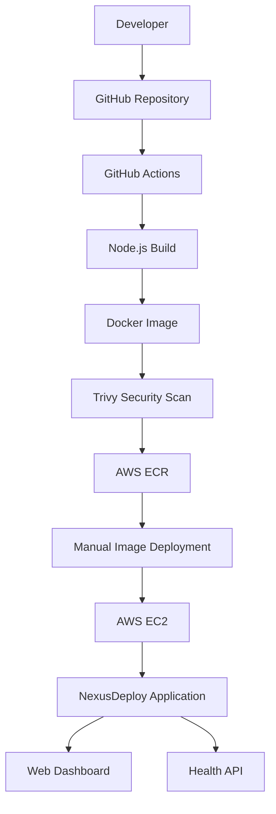

# NexusDeploy
### Automated CI/CD and Cloud Deployment Platform

NexusDeploy is a cloud-based deployment project designed to demonstrate a modern application delivery workflow using Docker, GitHub Actions, AWS Elastic Container Registry (ECR), and Amazon EC2.

The project includes a Node.js and TypeScript API with a professional monitoring dashboard, containerized application deployment, automated build and security scanning, and container image publishing to AWS ECR.

---

## Project Overview

NexusDeploy demonstrates how application code can move through a CI/CD workflow, from source control to container image creation and cloud deployment.

**Key objectives:**
- Build and containerize a Node.js application.
- Implement CI/CD using GitHub Actions.
- Scan Docker images for vulnerabilities using Trivy.
- Push versioned Docker images to AWS ECR.
- Deploy and run the application on an AWS EC2 instance.
- Display application health and version information through a web dashboard.

## Dashboard Screenshots

### 1. NexusDeploy Dashboard


### 2. GitHub Actions CI/CD Pipeline


### 3. AWS ECR Container Images


### 4. Application Health Check


> Screenshots will appear here after the image files are uploaded to the `screenshots/` directory.

## Architecture



## Technology Stack

| Category | Technologies |
|---|---|
| Application | Node.js, TypeScript, Express.js |
| Frontend | HTML, CSS, JavaScript |
| Containerization | Docker |
| CI/CD | GitHub Actions |
| Security Scanning | Trivy |
| Container Registry | Amazon ECR |
| Cloud Infrastructure | Amazon EC2 |
| Cloud Authentication | AWS IAM, GitHub OIDC |
| Version Control | Git, GitHub |

## CI/CD Workflow

The GitHub Actions workflow performs the following tasks:

1. Checks out the source code.
2. Sets up Node.js 22.
3. Installs project dependencies.
4. Builds the TypeScript application.
5. Authenticates with AWS using GitHub OIDC.
6. Builds the Docker image.
7. Scans the image using Trivy.
8. Pushes the image to Amazon ECR with version and latest tags.

The resulting container image is deployed to the EC2 instance.

**Deployment note:** EC2 deployment is currently performed manually using the published ECR image. Automated EC2 deployment is a future enhancement.

## Application API Endpoints

| Endpoint | Description |
|---|---|
| `/` | NexusDeploy dashboard |
| `/api/health` | Application health and uptime |
| `/api/version` | Application version and environment |

### Health Check Example

```json
{
  "status": "healthy",
  "uptime": 120,
  "timestamp": "2026-11-14T00:00:00.000Z"
}
```

The uptime and timestamp values are generated dynamically by the application.

## Project Structure

```text
NexusDeploy/
├── .github/
│   └── workflows/
│       └── ci.yml
├── public/
│   └── index.html
├── src/
│   └── index.ts
├── screenshots/
│   ├── dashboard.png
│   ├── github-actions.png
│   ├── ecr-images.png
│   └── health-check.png
├── Dockerfile
├── package.json
├── package-lock.json
├── tsconfig.json
└── README.md
```

## Run Locally

Clone the repository:

```bash
git clone https://github.com/saniabmw6-glitch/NexusDeploy.git
cd NexusDeploy
```

Install dependencies:

```bash
npm ci
```

Build the TypeScript application:

```bash
npm run build
```

Start the application:

```bash
node dist/index.js
```

Open the dashboard:

```text
http://localhost:3000
```

## Docker Deployment

Build the Docker image:

```bash
docker build -t nexusdeploy .
```

Run the container:

```bash
docker run -d \
  --name nexusdeploy \
  -p 3000:3000 \
  --restart unless-stopped \
  nexusdeploy
```

## AWS Deployment

The project uses:

- Amazon EC2 to host the application.
- Amazon ECR to store Docker images.
- IAM roles to control AWS permissions.
- GitHub OIDC for secure GitHub Actions authentication.

Sensitive credentials and secrets should not be committed to the repository.

## Learning Outcomes

Through this project, I gained practical experience in:

- CI/CD pipeline implementation.
- Docker image creation and deployment.
- AWS EC2 and ECR integration.
- GitHub Actions automation.
- Container security scanning.
- IAM roles and OIDC authentication.
- Application monitoring through API health checks.

## Future Improvements

- Fully automated EC2 deployment.
- Custom domain integration.
- HTTPS configuration.
- Advanced monitoring and alerting.

## Author

**Sania Chaudhary**

GitHub: [saniabmw6-glitch](https://github.com/saniabmw6-glitch)

Project: [NexusDeploy](https://github.com/saniabmw6-glitch/NexusDeploy)

---

*Developed as part of a hands-on DevOps and Cloud Engineering learning project.*
